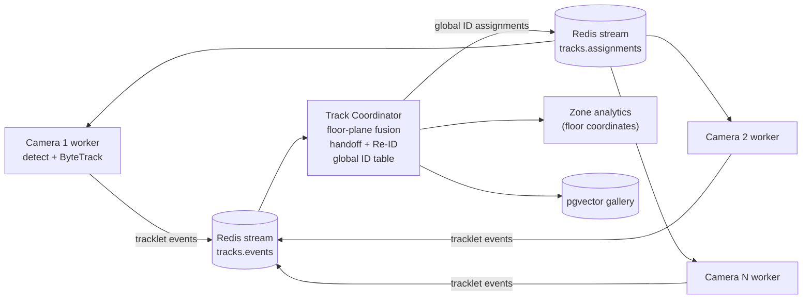

# OmniTrack Product Spec: What Store Owners and Ops Teams Get

13 Nov 2026 · Companion to [REMEDIATION_PLAN.md](REMEDIATION_PLAN.md)

This spec sets the product scope for selling OmniTrack to store owners and their operations teams: which pages exist, which numbers appear on them, and which alerts fire. The test for including anything is simple. A buyer must either make a decision from it or act on it during a shift. If nobody acts on it, it is not in the product.

**Data reality.** There is no product catalogue, no SKU-level detector and no sales (POS) data. The footage is public store videos taken from the internet. So every feature in this spec runs on **people and zones alone**: who is where, for how long, and in which order. Anything that would need to know *which product* someone picked, or *what sold*, has been reworded as an attention metric or dropped. Section 9 lists footage and datasets that fit this approach.

## 1. Who uses it and what they need

| Role | Where they use it | Questions they need answered | Main pages |
| --- | --- | --- | --- |
| **Owner** | Desktop or phone, once a day or once a week | Is traffic up or down? Are customers waiting too long? Is my layout working? Is the store safe? | Overview, Reports |
| **Store manager** | Desktop in the back office, through the day | When should I add staff? Which shelves are getting attention, and which ones are empty? Where are the queues building up? | Overview, Traffic, Zones, Checkout, Alerts |
| **Floor staff / shift lead** | Phone or a wall screen, live | What needs doing right now: open a lane, restock a shelf, clear a crowded area? | Live, Alerts (mobile) |
| **Security / loss prevention** | Desktop, during incidents | What happened, who was involved, and where did they go? I need a clip I can export. | Alerts, Investigations |
| **Admin / installer** | Desktop, during setup and when something breaks | Are all cameras online? Are the zones drawn correctly? Who can see what? | Setup, System Health, Audit Log |

## 2. Pages (11, plus Smart Store when enabled)

The navigation is grouped by job. Today the app has one page per AI model (Crowd, Emotion, Vibe, ReID, and so on), which reflects how it was built rather than what the buyer does.

```
MONITOR      Overview · Live · Alerts
ANALYSE      Traffic · Zones & Shelves · Checkout · Reports
INVESTIGATE  Investigations · Smart Store*
ADMIN        Setup · System Health · Audit Log
```

\* Smart Store appears only when the store profile has humanless checkout turned on.

### 2.1 Overview (owner, manager): the landing page

It covers today so far, compared with the same weekday last week. Last week is the default comparison because "vs yesterday" mixes weekdays with weekends and misleads.

- **KPI row:** Footfall · Peak occupancy (and the time it happened) · Average visit duration · Average checkout wait · Conversion rate (only when POS is connected) · Open alerts.
- **Hourly footfall:** today against the same weekday last week, as a line chart.
- **Zone heatmap:** a floor plan, or the camera snapshot, shaded by visits.
- **Alert feed:** the last 5 alerts, with links to each one.
- **Insights strip:** at most 3 plain-language lines, each generated by a rule rather than an LLM. Examples: "Queue wait over 5 min between 17:00 and 18:00 on 4 of the last 7 days" and "Aisle 3 visits down 22% vs last week."

### 2.2 Live (floor staff, shift lead)

- A camera grid that shows confirmed tracks only (box plus ID), with zone outlines drawn as an overlay.
- Live occupancy for the whole store and for each zone, shown against capacity and coloured green, amber or red.
- Each checkout lane's live queue length and current wait.
- Active alerts pinned at the top, with an acknowledge button.
- A full-screen mode for a wall TV, and a layout that works on a phone.

### 2.3 Alerts (everyone; the mobile view matters most)

An inbox with the alert lifecycle: **New → Acknowledged → Resolved** (or **False alarm**).

- Filters for severity, type, zone, camera, status and date.
- Each alert shows a snapshot plus a 10 s evidence clip (5 s before, 5 s after), the zone and camera, the rule that fired, the person who acknowledged or resolved it, and how long that took.
- The "False alarm" button feeds a precision figure for each rule, which is shown in Setup → Alert rules.
- The full rule catalogue is in section 4.

### 2.4 Traffic (manager, owner): this page merges today's Crowd and Peak Hours pages

- **Footfall:** entries and exits counted at the entry line, shown by hour, day and week.
- **Occupancy over time:** shown against capacity, with time spent above capacity reported as a total in minutes.
- **Peak hours heatmap:** day of week against hour, over the last 4 weeks.
- **Staffing guide:** recommended staff per hour, calculated from footfall and queue history with a ratio the owner sets in Setup (for example 1 staff member per 15 people in store). The guide is a table, not a model.
- **Average visit duration:** first seen to last seen for each visitor, and its distribution.

### 2.5 Zones & Shelves (manager, merchandising): this page replaces today's Shelf page

Each zone row shows:

- passers-by
- visits (stopped ≥ 3 s)
- stop rate
- median dwell
- engaged visits (> 10 s)
- trend vs last week

Two charts sit above the rows: zone ranking by visits and by stop rate, and a dwell heatmap.

- **Most-engaged zones.** This replaces "top-selling" and needs no product data. Zones are ranked by an **attention score**: engaged visits × median dwell, normalised to the busiest zone (100). The page states what it measures: "where customers spend attention", not "what sells". Comparing it with how many people pass each zone shows the layout opportunities: zones many people walk past but few stop at.
- **Shelf interactions (optional stretch).** A pose model (`yolo11n-pose`, pretrained on COCO, so no product data is needed) runs only on tracks standing in a shelf zone. A *reach* is a wrist keypoint inside the shelf polygon for at least 0.5 s. Reported as reaches per visit. It is evaluated on the MERL Shopping dataset's "reach to shelf" labels (section 9). Leave it out if Phase 3 runs late.
- **Customer flow:** the top zone-to-zone paths during a visit, shown as a Sankey or a ranked list. This is the one place where re-identification adds value for owners.

### 2.6 Checkout (manager, shift lead)

For each lane, and for the store as a whole:

- **Average and p90 wait.** Wait is measured from queue entry to counter entry.
- **Average service time.**
- **Queue length over time.**
- **Throughput per hour.**
- **Queue abandonment:** people who joined the queue and left without reaching the counter.
- **Lanes open against lanes needed,** by hour, where "needed" comes from the wait target set in Setup.

### 2.7 Reports (owner)

- Daily and weekly summaries arrive by email as a PDF covering Overview, Traffic, Checkout and the alert summary.
- Period comparison: any two date ranges side by side.
- A CSV export for every chart.
- A store comparison table, shown only when the account has more than one store.

### 2.8 Investigations (security, manager): merges today's ReID, Synopsis and Trim pages

- **Person search:** upload an image or click a person in a clip. The results are matching sightings across cameras, with times.
- **Journey:** a global ID's path through zones and cameras over a visit, laid out as a timeline.
- **Video synopsis:** pick a camera and a time range to get a condensed clip, with filters for zone and duration.
- **Clip export:** trim and download footage. Every export is written to the audit log.
- Investigations is the only page that shows individual people. Access is limited to the Security and Admin roles.

### 2.9 Smart Store (only when humanless checkout is turned on)

Virtual carts need product recognition, which the system does not have. Today the cart events are simulated. Keep the page off by default. If it is shown at the viva, label it "simulated cart events" on screen and present it as an integration point for a future product model. Do not present it as working AI.

### 2.10 Setup (admin, manager)

1. **Store profile:** name, address, timezone, opening hours, total capacity, currency, and whether humanless mode is on.
2. **Cameras:** source URL, name, location, enable or disable, and a test-connection button.
3. **Zones:** draw polygons on a camera snapshot. Each zone has one of these types:
   - `entry_line` (for counting)
   - `crowd` (with a capacity)
   - `shelf` (with a free-text label such as "Snacks aisle" or "Promo end-cap", which replaces product mapping)
   - `queue` and `counter` (paired per lane)
   - `restricted` (staff only)
   - `staff` (excluded from customer counts)

   Each uploaded video counts as its own camera with its own zones. That is how public footage from different stores fits into one demo store.
4. **Alert rules:** turn each rule on or off and set its thresholds, schedule, recipients and channels. Each rule's measured precision is shown here.
5. **Targets:** maximum checkout wait, staff-to-customer ratio, and occupancy capacity.
6. **Users and roles:** see section 5.
7. **Integrations:** email/SMTP, SMS or WhatsApp, and webhooks. POS is an optional connector that only unlocks conversion rate. It is not built or demoed, because there is no POS data.
8. **Privacy:** retention periods (video default 30 days, aggregates 13 months), face blurring (on by default), and turning optional modules on or off (section 6).

### 2.11 System Health (admin): replaces the "Model Health Check" page

- Each camera's status (online, offline or degraded), last frame time, processing FPS, and errors in the last hour.
- Model status: which weights are loaded and when.
- Storage use against retention.
- Uptime for the last 30 days.

The adversarial and robustness check moves to the engineering Evaluation page (Remediation Plan, Phase 4). It is not a buyer feature.

### 2.12 Audit Log (admin)

A tamper-evident list of logins, setting changes, rule changes, clip exports, person searches and alert actions. It has a "Verify chain" button.

**The user menu** holds theme and accent, which replaces today's standalone Settings page, plus the user's profile, notification preferences and logout.

## 3. KPI definitions

Every number in the product comes from this table. Each one is computed from confirmed tracks, zone events or POS data. When there is no data, the page shows an empty state, never an estimate.

| KPI | Definition | Source | Shown on |
| --- | --- | --- | --- |
| Footfall | Customer tracks crossing the `entry_line` inward, deduplicated by global ID within one visit | Entry-line events | Overview, Traffic, Reports |
| Occupancy | Confirmed customer tracks inside the store (or a zone) right now, median-smoothed over 3 s | Tracks + zones | Overview, Live, Traffic |
| Peak occupancy | The maximum occupancy in the period, and when it happened | Occupancy series | Overview, Traffic |
| Time over capacity | Minutes when occupancy was above the configured capacity | Occupancy series | Traffic |
| Visit duration | Time from a global ID's first sighting to its last within one visit (a gap of more than 10 min ends the visit) | Re-ID tracks | Overview, Traffic |
| Zone visits | Tracks whose foot point stays in the zone for at least 3 s | Zone events | Zones |
| Stop rate | Zone visits / passers-by (tracks that entered the zone for any amount of time) | Zone events | Zones |
| Median dwell | Median time spent in the zone per visit | Zone events | Zones |
| Engaged visits | Zone visits with dwell over 10 s (the threshold is configurable) | Zone events | Zones |
| Attention score | Engaged visits × median dwell for the zone, scaled so that the top zone = 100 | Zone events | Zones (most-engaged ranking) |
| Shelf reaches (optional) | Wrist keypoint inside the shelf polygon for at least 0.5 s, while the person's foot point is in the zone | Pose model + zone events | Zones |
| Queue length | Median number of tracks in the `queue` polygon over 2 s | Zone events | Live, Checkout |
| Checkout wait | Time per track from entering the queue to entering the counter; reported as average and p90 | Zone events | Overview, Checkout |
| Service time | Time per track inside the `counter` polygon | Zone events | Checkout |
| Throughput | Counter exits per hour | Zone events | Checkout |
| Queue abandonment | Tracks that entered the queue and left without reaching the counter / all queue entries | Zone events | Checkout |
| Conversion rate | POS transactions / footfall, per hour | POS + footfall | Hidden unless a POS is connected (not demoed) |
| Alert response time | Time from an alert firing to its acknowledgement, and to its resolution | Alert log | Alerts, Reports |

Two rules apply to every KPI.

**Staff are excluded.** Tracks whose dwell is mostly inside `staff` or `counter` zones during the shift are classed as staff and left out of customer KPIs. The UI shows a note such as "Customer counts exclude staff (estimated)".

**Comparisons are like for like.** The default comparison is the same weekday last week. A delta appears only when the comparison period has data.

## 4. Alerts

### 4.1 Rule catalogue

| Alert | Trigger (default; every threshold is editable) | Severity | Goes to | Action expected |
| --- | --- | --- | --- | --- |
| **Fire / smoke** | 3 of the last 5 inferences with confidence ≥ 0.5; clears after 30 s with no detection | Critical | Everyone on duty + owner: push, SMS, siren on the Live screen | Check and evacuate |
| **After-hours intrusion** | A person is detected outside opening hours | Critical | Owner + security: push, SMS | Check the camera, call security |
| **Restricted area entry** | A non-staff track enters a `restricted` zone | High | Security + shift lead | Check |
| **Overcrowding** | Zone or store occupancy is at or above 90% of capacity for 60 s | High | Shift lead + manager | Manage entry, redirect customers |
| **Long queue** | Queue length ≥ 5 **or** p90 wait ≥ target (default 5 min) for 2 min | Medium | Shift lead | Open another lane |
| **Unattended checkout** | Queue length ≥ 1 and the `counter` zone has been empty for 60 s | Medium | Shift lead | Send a cashier |
| **Loitering** | One track dwells in a configured sensitive zone (high-value shelf, entrance) for 5 min or more | Medium | Security | Observe, offer assistance |
| **Camera offline / view blocked** | No frames for 60 s, or the image is mostly uniform (covered or blurred) for 60 s | High | Admin + manager | Fix the camera |
| **Pipeline degraded** | Processing FPS stays below 50% of target for 5 min | Low | Admin | Check the server |

Fall detection, weapon detection and face-watchlist alerts are **not** in scope. The system has no models for them, and watchlists bring legal risk. Do not show them as "coming soon" in the demo.

Shelf gap / low-stock alerts and Smart Store cart-mismatch alerts are also out of scope, because both need product data. Section 9 names the dataset that could bring shelf gaps back later.

**Testing alerts on public footage:** after-hours intrusion and restricted-area entry are shown by setting the store's opening hours, or by drawing a `restricted` zone, so that the clip's activity falls inside the rule. The demo says so openly: "this rule, applied to this clip".

### 4.2 Rules every alert follows

- **Evidence:** every alert carries a snapshot and a 10 s clip. An alert without evidence is not trusted.
- **De-duplication:** the same rule in the same zone does not re-fire within a cooldown (default 5 min). Repeat triggers increase a count on the open alert instead.
- **Escalation:** an unacknowledged Critical alert escalates to the owner after 2 min. An unacknowledged High alert escalates to the manager after 10 min.
- **Schedules:** each rule runs only during the hours it is set for. For example, intrusion runs only when the store is closed, and long queue only when it is open.
- **Channels:**
  - in-app and push (all severities)
  - email (High and above, plus the daily digest)
  - SMS or WhatsApp (Critical only)
  - a webhook for each rule
- **Feedback:** "False alarm" is one tap. The precision of each rule over the last 30 days is shown in Setup. A rule that falls below 80% precision is flagged for tuning.
- **Daily digest:** a count by type, the median response time, and any unresolved alerts.

## 5. Roles and permissions

| Capability | Owner | Manager | Shift lead | Security | Admin |
| --- | :-: | :-: | :-: | :-: | :-: |
| Overview, Traffic, Zones, Checkout, Reports | ✓ | ✓ | Overview only | — | ✓ |
| Live view | ✓ | ✓ | ✓ | ✓ | ✓ |
| Alerts: view and acknowledge | ✓ | ✓ | ✓ | ✓ | ✓ |
| Investigations: person search, journey, clip export | ✓ | — | — | ✓ | ✓ |
| Smart Store | ✓ | ✓ | ✓ | ✓ | ✓ |
| Setup: zones, alert rules, targets | ✓ | ✓ | — | — | ✓ |
| Setup: cameras, integrations, users, privacy | ✓ | — | — | — | ✓ |
| System Health | ✓ | ✓ (read only) | — | — | ✓ |
| Audit Log | ✓ | — | — | — | ✓ |

## 6. What changes from the current app

| Current page | Decision | Reason |
| --- | --- | --- |
| Dashboard | **Rebuild** as Overview | Section 2.1. Remove the hardcoded deltas and the Engagement series. |
| Video Feeds (Detection) | **Rename** to Live | Show tracks only, add occupancy and queue panels. |
| Crowd | **Merge** into Traffic and Live | Occupancy is one KPI, not a page of its own. |
| Peak Hours | **Merge** into Traffic | |
| Shelf | **Rebuild** as Zones & Shelves | Add stop rate, availability and flow. |
| Checkout | **Keep and fix** | Needs queue and counter zones to work. |
| Fire | **Fold** into Alerts | Fire is an alert type. A history filter on Alerts covers what the page did. |
| ReID, Synopsis, Trim | **Merge** into Investigations | One place for incident work, restricted by role. |
| Smart Store | **Off by default**, labelled as simulated | No product recognition, so cart events are not real. |
| Setup | **Keep and extend** | Add zone types, alert rules, targets and privacy. Remove the Products step. |
| Audit | **Keep** | Add the verify button. |
| Security (Model Health Check) | **Replace** with System Health | Robustness testing moves to the engineering Evaluation page. |
| Settings | **Move** into the user menu | Theme is not a page. |
| Emotion, Store Vibe, Demographics | **Optional modules, off by default**, under Setup → Privacy | See below. |

**Why emotion, vibe and demographics are off by default.** An owner cannot act on a "vibe score". Emotion and age/gender estimates on CCTV-resolution faces are inaccurate. In many markets they are also biometric processing that needs consent and signage. The FYP proposal promises them, so keep them working and demonstrate them as optional modules with their measured accuracy shown. Do not put them on the Overview, and do not include them in the default product.

## 7. What the backend must provide

This maps onto Phase 3 of the Remediation Plan.

- **Event tables:** `zone_events` (enter, exit, dwell, camera, track, global ID, time), `line_crossings`, `queue_samples`, `reach_events` (only with the optional pose model), and `alerts` (lifecycle, evidence paths, acknowledged or resolved by whom and when, false-alarm flag).
- **Aggregates:** hourly rollups per store, zone and lane, built by a scheduled job, so that pages never scan the raw events.
- **API:** one endpoint per page that returns everything the page needs for a time range and a comparison range. Examples:
  - `GET /api/overview?from&to&compare=last_week`
  - `GET /api/traffic`
  - `GET /api/zones`
  - `GET /api/checkout`
  - `GET /api/alerts`
  - `POST /api/alerts/{id}/ack|resolve|false-alarm`
  - `GET /api/reports/daily.pdf`
- **Notifications:** a single dispatcher that applies cooldown, escalation and channel routing, and has one adapter for each channel.
- **Empty states:** every endpoint returns `"status": "no_data"` rather than a made-up value.

## 8. Demo walkthrough for buyers (5 minutes)

1. **Overview.** Present the day in one sentence: "Footfall is up 8%, the queue peaked at 17:30, and two alerts are open."
2. **Alert on the phone.** A long-queue alert arrives. Acknowledge it and show the evidence clip.
3. **Live.** Show the queue panel going back to green after a second lane opens. The second lane is simulated with a clip.
4. **Zones.** Show which shelf has a high number of passers-by but a low stop rate. That gives the owner a layout decision to make.
5. **Checkout.** Show the lanes-needed chart and use it to set tomorrow's rota.
6. **Investigations.** Search for a person from an incident, follow their journey, and export the clip. Then show the clip export entry in the Audit Log.
7. **Fire.** A fire clip triggers the critical alert: an SMS goes out and the alert escalates.

## 9. Footage and datasets (no product or sales data needed)

Public store videos found online are fine for the **demo**. For **numbers in the report**, use datasets that come with ground truth, or annotate your own chosen clips in CVAT. Every dataset below centres on people, except the two marked optional.

### 9.1 Datasets with ground truth

| Dataset | What it is | Use it for | Where |
| --- | --- | --- | --- |
| **CAVIAR (shopping centre set)** | Shopping-centre corridor in Lisbon, filmed by **two synchronised views** (corridor and front). People walk, browse, and go in and out of shops. Boxes and IDs labelled for every frame. Low resolution (384×288). | Tracking (IDF1/HOTA), shop entry/exit counting, dwell, and **cross-view Re-ID**. It is the closest public match to the "same person on two cameras" claim. | homepages.inf.ed.ac.uk/rbf/CAVIAR/ |
| **Mall dataset** (Loy et al.) | 2,000 frames from a shopping-mall surveillance camera, with every head annotated | Crowd count and occupancy accuracy (MAE), which replaces "200 frames we labelled" | Search "Mall dataset crowd counting CUHK" |
| **MERL Shopping** | 106 top-down videos of about 2 min each, recorded in a mock store, with labels for *reach to shelf*, *retract*, *hand in shelf*, *inspect product* and *inspect shelf* | Shelf engagement and the optional reach detector (precision/recall of reach events). No product labels needed. | Search "MERL Shopping Dataset" (merl.com) |
| **UCF-Crime (Shoplifting, Stealing, Burglary classes)** | Real CCTV footage, much of it inside stores, with video-level labels only | **Realistic demo footage** and qualitative tracking/loitering examples. It does not provide tracking metrics. | crcv.ucf.edu/projects/real-world/ |
| **Market-1501, MSMT17** | Standard person Re-ID benchmarks | The Re-ID Rank-1 / mAP numbers from the proposal | Already in the plan |
| **MOT17 / CrowdHuman** | Pedestrian tracking and crowded-person detection | Detector and tracker benchmarks, and fine-tuning | Already in the plan |
| **MMPTRACK** (Microsoft, ICCV 2021) | About 9.6 hours of multi-camera video across 5 rooms, **one of them a retail store**. Shoppers push carts, carry baskets and queue at checkout. Includes per-frame boxes, IDs and **camera calibration**. | The best public match for "cameras sharing tracking data in a store": cross-camera tracking, floor-plane fusion and handoff. Research use only. To request access, sign the user agreement and email it to iccv2021mmp@outlook.com with the subject "MMPTracking Challenge data request". | iccv2021-mmp.github.io/subpage/dataset.html |
| **WILDTRACK** (EPFL) | 7 synchronised, overlapping cameras with person labels, outdoors on a campus | Multi-camera association, if CAVIAR's two views are not enough | Search "WILDTRACK dataset EPFL" |
| **AI City Challenge, multi-camera people tracking track** | Large synthetic indoor scenes covering many cameras, with full ground truth | Stress-testing cross-camera Re-ID at scale. Check which year's release includes store-like scenes. Access is by request. | aicitychallenge.org |
| *Optional:* **SKU-110K** | 11,762 images of densely stocked shelves, with every item boxed as one class (no SKUs) | Shelf fullness and gap detection, only if you later want stock alerts back. Ultralytics ships it as `SKU-110K.yaml`. | docs.ultralytics.com/datasets/detect/sku-110k/ |
| *Optional:* **AI City Challenge, retail checkout track** | Synthetic product images plus real checkout videos for 116 products | Product recognition at checkout. This is the only realistic route to real Smart Store carts, and it is out of scope for now. | aicitychallenge.org |

### 9.2 Free stock footage for the demo

Use **Pexels** and **Pixabay** videos. Both licences allow free use, including in a recorded demo, with no attribution required. Useful searches: "supermarket cctv", "grocery store shoppers", "checkout queue", "store entrance people", "shopping mall surveillance". Use YouTube CCTV compilations for private testing only. Leave them out of the submitted demo video and the report unless you have permission.

### 9.3 How to pick a clip

A clip is usable only if it passes every item on this list:

- **Fixed camera.** No panning, zooming or cuts. Compilations with cuts break tracking.
- **Raised CCTV-style angle.** People are at least 80 px tall at 720p.
- **At least 2 minutes long** at 720p or higher.
- **Shows one of the scenes the demo needs:**
  - an **entrance** (for the entry line and footfall)
  - an **aisle with shelves** (for zones and attention)
  - **a checkout with a queue** (for wait and service time)
  - a **busy open area** (for crowd and overcrowding)
- **No burnt-in overlays** covering people, such as large logos or subtitles.

Collect **2 clips per scene** (8 in total), and save the source URL and licence in `data/videos/SOURCES.md`. Annotate one clip per scene in CVAT (2 min each) so that every page in the demo has a matching accuracy figure.

### 9.4 How to present it in the report

- **"Top-selling products" becomes "most-engaged zones".** Dwell and stop rate are the standard footfall-analytics proxies for shopper interest. Without POS data the system measures attention, not sales, and the report says this plainly.
- **Multi-camera tracking is shown on footage where the cameras really film the same space.** That means CAVIAR's two synchronised views (downloaded) and MMPTRACK's retail room (on request). Separate online clips cannot show cameras sharing data, because they come from different stores. Use those clips for the single-camera pages only.

## 10. How cameras share tracking and detection data

A store is a single space, so cameras cannot work in isolation. If they do, one shopper becomes three "people" and store occupancy is triple-counted. The cameras share data through a central **Track Coordinator**: one process, using the Redis already in `docker-compose.yml`.



**What each camera publishes.** On every update of a confirmed track, the camera publishes:

- `camera_id`, local `track_id`, and the capture timestamp
- the box and the **foot point in floor coordinates** (metres)
- a quality-gated appearance embedding, at most once per second

Each camera worker subscribes to the assignments stream, so it always knows the global ID of its own tracks. That global ID is the one drawn in Live.

**What the coordinator does:**

1. **Floor-plane calibration.** In Setup → Cameras, the installer clicks at least 4 floor points on each camera's snapshot and the matching points on a floor plan. That gives a homography per camera, so every foot point from every camera lands in the same floor coordinates.
2. **Overlapping cameras: fusion.** Two tracks from different cameras are the same person when, at the same moment, their floor positions are within 0.75 m for 1 s or more **and** their appearance agrees. Store-wide occupancy and footfall then count each person once.
3. **Non-overlapping cameras: handoff.** When a track is lost in an exit area of camera A, the coordinator posts an *expected arrival* to the cameras adjacent to A, valid for the configured transit time. A new track on camera B is matched first against those expected candidates, using Hungarian assignment on appearance, timing and topology. Only after that is it searched against the full gallery.
4. **One shared gallery.** All cameras read and write one identity gallery (pgvector). Only high-similarity, high-quality crops update it.
5. **Zones in floor coordinates.** A zone that two cameras both see is one zone. Dwell carries across cameras without restarting.
6. **Shared detections for alerts.** An alert is raised once per incident, not once per camera. Fire seen by two cameras, or an intrusion that crosses views, becomes one alert that lists every camera as evidence.
7. **Time alignment.** Every event carries the frame capture time. For recorded clips, Setup stores a per-camera time offset, so the synchronised views stay aligned.

**How this is measured:**

- cross-camera IDF1 on CAVIAR's two views (and on MMPTRACK retail, if access is granted)
- **double-count rate**: the % of people in the overlap area counted more than once (target < 5%)
- handoff accuracy: the % of camera-to-camera transitions that keep the same global ID

**In the demo:** play the two CAVIAR views side by side. The same person keeps the same global ID in both views, the occupancy number goes up once rather than twice, and the floor-plan view shows a single dot moving across both cameras' coverage.
