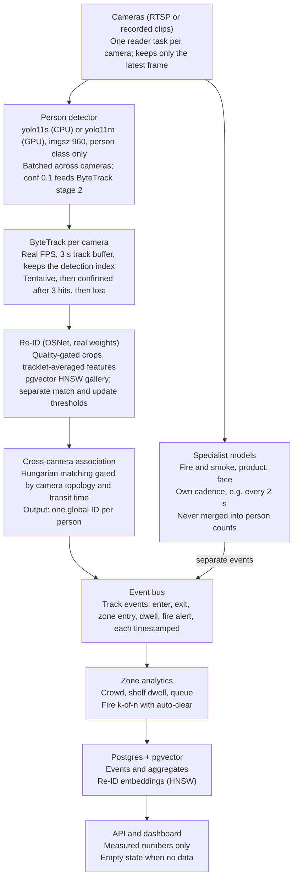
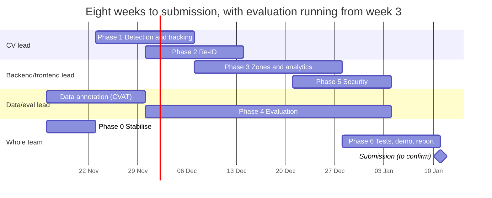

# OmniTrack FYP-II Remediation Plan

13 Nov 2026

The pipeline is unreliable because of how it is built, not only because of bugs. It draws raw detections instead of confirmed tracks. It merges several model weights into one person stream, and it starves ByteTrack of low-confidence boxes. It runs every camera in one lockstep loop, and its analytics fall back to random numbers. This plan rebuilds the core around one person detector and one tracker per camera. Every analytic then comes from confirmed tracks inside drawn zones. Everything is then measured against the proposal's success criteria, in eight weeks.

## Why it breaks today

Every symptom the team sees traces back to a specific cause in the code. All of these were confirmed by reading the source on 13 Nov.

| Symptom | Root cause | Where |
| --- | --- | --- |
| Nothing works | `tracker_backend` is read outside the function that defines it. The resulting NameError is caught and logged, so every tick is silently thrown away. | `pipeline.py:1540` |
| Nothing works | Frames are fetched one camera at a time, with a 1 s timeout each. One dead camera stalls every camera. | `pipeline.py:1405` |
| Nothing works | If one camera fails detection, a KeyError in phase 3 kills the whole tick. Phase-1 failures are logged only at debug level. | `pipeline.py:1504, 1735` |
| Fake numbers | When there is no data, the routers return `random.uniform` and `random.randint` values for shelf, checkout, emotion, vibe, crowd history and peak hours. | `analytics.py:256-763` |
| Fake numbers | The "vs yesterday" deltas and the Engagement series on the Dashboard are hardcoded. | `DashboardPage.jsx:150, 235-240` |
| Fake numbers | Shelf zones and checkout lanes are never created, so those modules can only ever return random data. | `pipeline.py:559` |
| Fake numbers | The emotion module labels every face "neutral". There is no emotion classifier. | `emotion.py:57` |
| Duplicate boxes | Several weights (yolov8n, yolo11n, yolo26n, face, product) are merged into one person stream. IoU-0.5 merging leaves duplicates, and product, fire and face boxes are counted as people. | `model_selection.py:73`, `pipeline.py:379` |
| Duplicate boxes | Raw detections are drawn and counted instead of confirmed tracks, so one-frame false positives flicker on screen. | `pipeline.py:1488` |
| Duplicate boxes | Detections are matched back to tracks by greedy IoU ≥ 0.3, so two people can share one ID. ByteTrack's exact detection index is thrown away. | `pipeline.py:736`, `tracker.py:176` |
| ID switches | Detector confidence is 0.5, so ByteTrack never sees the low-score boxes its second association stage depends on. | `config.py:88` |
| ID switches | The tracker's frame rate is not set to the real processing FPS, so lost tracks expire at the wrong time. | `tracker.py:110` |
| Wrong global IDs | OSNet is loaded with ImageNet weights only, so it is not a re-identification model. Stable tracks also write into the gallery with no similarity check, so a single ID swap contaminates it. | `reid.py:174`, `pipeline.py:1004` |
| Lost IDs on restart | Gallery warm-up calls `float()` on a DateTime. The error is swallowed, so 0 identities are restored. | `pipeline.py:1228` |
| No fire alerts | The config names `fire_smoke.pt` but the file is `fire-smoke.pt`. When it does load, one frame raises an alert that never clears. | `config.py:90`, `pipeline.py:1779` |
| Slow and laggy | Gallery search, drawing, JPEG encoding and video writing all run on the asyncio event loop, and one model lock serialises every camera. | `pipeline.py:1662-1985` |

## Target pipeline

Everything after the event bus reads confirmed tracks with global IDs. Nothing downstream reads raw detections, and the fire, product and face models never add to person counts.

## Phase 0: Stabilise (week 1)

Done means a 10-minute recorded clip runs end to end with zero errors in the log, and no page shows a number that was not computed from video.

- [x] Fix the `tracker_backend` NameError: return it from `process_camera_detection` alongside `tracker_reason`.
- [x] Delete every `random.*` fallback in `analytics.py`. Return an empty list plus `"status": "no_data"` so the frontend's empty states appear.
- [x] Remove the hardcoded `delta` props and the fake Engagement series from `DashboardPage.jsx`. Show a delta only when yesterday's value exists in the database.
- [x] Set `ALLOW_MOCK_AI=false` everywhere. Make startup fail loudly if a configured weight is missing.
- [x] Rename `FIRE_MODEL_PATH` to `fire-smoke.pt` and resolve it relative to `MODEL_WEIGHTS_DIR`.
- [x] Raise per-camera exceptions at WARNING level with a counter. Isolate failures so one camera cannot kill a tick.
- [x] Turn off `auto_all` and ensemble modes in the UI until Phase 1 replaces them.
- [x] Add `/api/pipeline/health` with, for each camera: last frame time, processed FPS, errors in the last minute, active tracks.
- [x] Fix the reference clips: a busy aisle and a checkout from public stock footage (see PRODUCT_SPEC.md §9), plus CAVIAR's two-view shopping-centre sequences for the handover. Every later phase is tested on these clips.

## Phase 1: Detection and tracking rebuild (weeks 2-3)

The rule from here on is that one person model feeds one tracker per camera, and only confirmed tracks are drawn, counted or analysed. Done means the reference clips show one stable box per person. ID switches on the busy-aisle clip should drop by at least half against the week-1 baseline, measured with TrackEval.

**Detection**

- [x] Use one person detector for the person stream: `yolo11s` on CPU, or `yolo11m` on a GPU. Run at `imgsz=960`, because CCTV people are small. Drop the nano models from the person path. (done: yolo11s@640 on CPU per the Risks table, yolo11m@960 on GPU; `config.py:124-128`, `model_selection.py`)
- [x] Pass `classes=[0]`, `conf=0.1` and `iou=0.6` to the detector. The low confidence is deliberate, because ByteTrack decides what to keep.
- [x] Remove the cross-model ensemble from the person stream. Fire and product models become separate *specialist streams*, each on its own cadence (fire every 10 frames, product every 2 s). Their boxes never enter the tracker or the people counts.
- [x] Batch inference across cameras: one `model.predict([f1, f2, …])` per tick, run by a dedicated inference worker. The asyncio loop only does I/O. (done: `InferenceWorker`, `pipeline.py:163`)
- [ ] Export the detector to OpenVINO (CPU) or TensorRT FP16 (GPU), then measure FPS before and after. *(demo PC)*
- [ ] Optional, but strong for the viva: fine-tune on about 400 labelled frames from your own cameras, plus a CrowdHuman subset. Report mAP@0.5 before and after. *(demo PC)*

**Tracking**

- [x] Set the ByteTrack config explicitly: `track_high_thresh 0.5`, `track_low_thresh 0.1`, `new_track_thresh 0.6`, `match_thresh 0.8`, and `track_buffer` = 3 s × processing FPS. Pass `frame_rate` = the real processing FPS.
- [x] Use ByteTrack's returned detection index (`_idx`) to attach track IDs. Delete `_match_det_to_track` and its greedy IoU matching.
- [x] Add a track lifecycle: a track is *tentative* until it has 3 hits, then *confirmed*, then *lost* when it leaves the buffer. Only confirmed tracks reach drawing, counts, Re-ID and analytics.
- [x] Emit track events (`track_confirmed`, `track_updated`, `track_lost`) onto the existing event bus. Analytics consume events and no longer read raw detections. (done: events go to the local bus and Redis stream `tracks.events`; the zone engine is fed confirmed tracks + `track_lost` directly, `pipeline.py:1099-1135`)
- [x] Prune every per-track dict on `track_lost`. This fixes the unbounded growth in `tracker.tracks`, `_last_global_by_track` and `_last_reid_frame_by_track`.

**Pipeline structure**

- [x] Replace the single lockstep loop with one async task per camera that pushes frames to the shared inference worker. A dead camera then affects only itself.
- [x] Load models once at startup. Remove `unload()` on active detectors, and fix `MemoryGuard` so it lowers FPS instead of evicting models. (done: `Pipeline._check_memory` lowers FPS, `pipeline.py:1658`; the old `memory_guard.py` is no longer used)
- [x] Move drawing, JPEG encoding and video writing to a thread pool. Stream annotated frames only to viewers who are watching.
- [x] Log per-stage latency (decode, detect, track, Re-ID, analytics) and expose it on the health endpoint.

## Phase 2: Re-identification done properly (weeks 3-4)

The tracker owns identity within a camera. Re-ID decides only one thing: which global person a confirmed track is, when it first appears or reappears. Done means the two-camera handover clip keeps the same global ID for at least 80% of labelled people, with no gallery merges between different people.

- [x] Load real Re-ID weights with `torchreid.utils.load_pretrained_weights`. Use `osnet_x1_0` trained on Market-1501 for the benchmark. For your own store, use the MSMT17 or `osnet_ain_x1_0` cross-domain weights, which generalise better to unseen cameras. (done: `osnet_ain_x1_0` MSMT17 weights for both store and Market-1501 benchmark, `app/ai/reid.py:179`)
- [x] Gate crop quality before embedding. Require box height ≥ 128 px, aspect ratio 0.25-0.6, no contact with the frame edge, IoU < 0.3 with any other person (to skip occluded crops), and detector confidence ≥ 0.6. (done: min height relaxes to 25% of frame height on low-res cameras, `app/ai/reid.py:66-139`)
- [x] Use tracklet-level features: average the embeddings of the 5 best-quality crops over the track's life and L2-normalise. Never match on a single frame.
- [x] Make cross-camera matching an assignment problem. Run Hungarian matching between new tracklets and recently lost identities, so two new tracks cannot claim the same person.
- [x] Add camera topology: which cameras are adjacent, plus a minimum and maximum transit time. A match that breaks the topology is rejected, which removes most false merges cheaply.
- [x] Use two thresholds. *Match* when similarity ≥ T_match. *Update the gallery* only when similarity ≥ T_update (higher). Keep at most 8 diverse views per identity. This stops a single ID swap poisoning the gallery.
- [ ] Calibrate T_match on your handover clip: label 20-30 identities, sweep the threshold, and pick the point where precision ≥ 0.9. Put the curve in the report. *(demo PC)*
- [x] Add a central **Track Coordinator** (PRODUCT_SPEC.md §10). Camera workers publish confirmed-tracklet events (foot point in floor coordinates plus an embedding) to a Redis stream. The coordinator owns the global ID table and publishes assignments back to every camera. (done in-process: `app/services/track_coordinator.py`; track events and assignments are mirrored to Redis streams `tracks.events` / `tracks.assignments`)
- [ ] Calibrate a floor-plane homography for each camera (at least 4 clicked floor points in Setup). Fuse tracks from overlapping cameras when their floor positions are within 0.75 m and their appearance agrees, so store occupancy counts each person once. Target: double-count rate under 5% on CAVIAR's two views. (built: Setup → Zones → Floor calibration takes 4+ clicked point pairs and fits the homography with a reported error, `PUT /api/reid/calibration/{id}`; fusion in `track_coordinator.py`, tests `test_fusion_on_calibrated_overlapping_cameras` and `test_floor_fit_*`. Open: the double-count measurement needs both views calibrated against measured floor points.)
- [x] Hand off between non-overlapping cameras: a track lost in camera A's exit area creates expected arrivals at adjacent cameras, and those candidates are matched first. (done: any lost track opens a transit window on each linked non-overlapping camera, and expected identities get `handoff_bonus` in the Hungarian cost, `app/services/track_coordinator.py`; tests `test_expected_arrival_is_matched_first` and `test_without_handoff_priority_the_closer_identity_wins`; shown as Expected arrivals on the Journeys page)
- [x] Fix gallery warm-up: convert the DateTime with `.timestamp()`, and log how many identities were restored.
- [x] Use pgvector HNSW (`vector_cosine_ops`) for the persisted gallery. Keep the in-memory gallery only for identities seen in the last few minutes.
- [x] Delete the unused `reid_backend.py` and `vector_store.py`, or wire them in. Dead code with mock fallbacks invites awkward viva questions.

## Phase 3: Analytics rebuilt on track events (weeks 4-6)

Every analytic gets a written definition, an input of confirmed tracks inside drawn zones, and a ground-truth check. A person is "in" a zone when their *foot point* (the bottom-centre of the box) is inside the polygon, not when their box overlaps it.

- [x] **Zone editor (do this first).** On the Setup page, let an operator draw polygons on a camera snapshot. Zone types: `crowd`, `shelf`, `queue`, `counter`, `entry_line` (plus `restricted`, added later). Store them per camera in the database and load them into the analytics at camera start. Without this, shelf and checkout cannot work.

| Module | Definition to implement | Ground-truth check |
| --- | --- | --- |
| Crowd density | Confirmed tracks in the polygon, median-smoothed over 3 s. Levels come from the zone's capacity (10/30/60/90%), with hysteresis so the level does not flicker. | 200 labelled frames, crowded vs not. Target > 85% accuracy. |
| Shelf engagement | A dwell starts after 3 s inside a shelf polygon and ends after 1 s outside. Dwells are keyed by (camera, track), which fixes the multi-camera bug. Metrics: visits, median dwell, and engaged visits (dwell > 10 s). | Hand-timed dwells on 20 people. Error under 2 s. |
| Most-engaged zones (replaces "top-selling") | Attention score = engaged visits × median dwell, scaled so the top zone = 100. No product or sales data needed. Optional: pose-based shelf reaches. | Reach events against MERL Shopping labels (only if the optional reach detector is built). |
| Checkout | Queue length = median count in the `queue` polygon over 2 s. Wait time = queue entry to counter entry, per track. Service time = time in the `counter` polygon. Throughput = counter exits per hour. | Manual counts on 3 clips. Queue length within ±1 person (the proposal target). |
| Fire and smoke | An alert needs 3 hits in the last 5 inferences, each with confidence ≥ 0.5 and a minimum box area. It clears after 30 s with no detection, with a cooldown. Boxes are converted to xywh like everything else. | D-Fire test split plus 30 min of negative store footage (red clothing, lights, glare). Precision > 90%, false-positive rate < 5%. |
| Emotion | Detect faces with `face11n.pt`, keep faces ≥ 48 px, classify them with a real FER model (for example HSEmotion or a FER-2013 mini-Xception as ONNX), then aggregate per zone per 5 min. Blur any stored face crops. | Report FER-2013 test accuracy for the model you ship. |
| Store vibe | A documented weighted formula over measured signals only: occupancy %, flow rate, engaged-visit rate, sentiment (when emotion is real). Show the components next to the score. | None needed; it is a composite. Explain the formula in the report. |
| Video synopsis | Stream activity tubes (boxes + frame indices) to disk. Build the background from a median of about 50 sampled frames, then composite in one streaming pass. This removes the memory blow-up. | Measured compression on three clips of 30 min or more, plus the % of tubes preserved. Target ≥ 10× with 100% of events kept. |
| Peak hours, demographics | Database aggregates only. An empty result means an empty chart. | Check against counts from the raw tables. |

- [x] Write a unit test for each definition above: zone membership, dwell start and end, queue median, fire hysteresis. These are pure functions and quick to test.

**Added during the build (not in the original plan; all done and tested).**

- [x] **Restricted area zones.** A sixth zone type. A person whose foot point stays inside for 2 s raises one high-severity `intrusion` alert with a snapshot and clip; the same person on a new track ID does not re-alert. Brief edge contact does not alert. The Overview shows a red banner while one is open. (`app/analytics/engine.py`, tests `test_restricted_zone_*`)
- [x] **Dwell-overrun alerts without false positives.** Deduplicated by global ID, evidence boxed on the person, and a 60 s default threshold. (`_dwell_overrun`)
- [x] **Fire overlay gate.** Only boxes that can count towards an alert (confidence and minimum area) are drawn, so red signage or warm lights below the threshold never look like fire to an operator. (`fire_qualifies`)
- [x] **Floor heatmap.** Foot points weighted by seconds present, over the last 15 min to 24 h, per camera. (Floor → Heatmap, `GET /api/zones/cameras/{id}/heatmap`)
- [x] **Find this person.** The best quality-gated crop of each global ID is kept in memory and served at `GET /api/reid/thumb/{global_id}`. The Journeys page shows thumbnails and "Find similar people" (pgvector search ranked by confidence). Identities restored from the database after a restart have no crop and show an icon; no image is invented.
- [x] **Fewer, non-duplicated pages.** Hub pages with tabs: Incidents (alerts, evidence, fire), Floor (heatmap, footfall, rush hours, queues, shelves), Shoppers (mood, audience), System (security, activity, evaluation, account). Setup and Inventory pages without real data were removed.

## Phase 4: Evaluation against the proposal's success criteria (weeks 3-7)

The proposal makes 11 measurable promises. Right now none of them has a reproducible number behind it. Each row below becomes one script in `eval/` that writes a JSON result. Those results feed the report tables and a read-only **Evaluation** page in the app, so the demo shows measured numbers, not claims.

| Proposal criterion | Dataset | How to measure | Tool / script |
| --- | --- | --- | --- |
| Person detection > 85% mAP@0.5 | 300 frames from your own store footage, labelled in CVAT, plus the MOT17 val split | Val run on the chosen detector at the chosen imgsz | `yolo val`, `eval/detect.py` |
| Tracking quality (not in the proposal, but examiners will ask) | CAVIAR shopping-centre sequences (ground truth included), MOT17, and 2 reference clips annotated in CVAT | IDF1, MOTA, HOTA, ID switches, before and after the Phase 1 fixes | TrackEval, `eval/track.py` |
| Re-ID Rank-1 > 70% on Market-1501 | Market-1501 query/gallery | Rank-1 and mAP with the shipped weights, then cross-domain on 50 identities from your own cameras | torchreid `engine.test`, `eval/reid.py` |
| Search < 100 ms | 100k synthetic embeddings in pgvector (HNSW) | p50/p95 latency of the top-10 query, 1,000 runs | `eval/search_latency.py` |
| Fire > 90% precision, < 5% FPR | D-Fire test split plus 30 min of negative store video | Event-level precision and false-positive rate with the k-of-n rule | `eval/fire.py` |
| Crowd > 85% accuracy | Mall dataset (2,000 frames with head annotations) | Count MAE and level accuracy against the annotations | `eval/crowd.py` |
| Checkout queue ±1 | 3 annotated clips | Mean absolute error of queue length per 10 s window | `eval/checkout.py` |
| Emotion > 70% on FER-2013 | FER-2013 test split | Accuracy of the shipped model (or descope, see Risks) | `eval/emotion.py` |
| Synopsis ≥ 10× | 3 clips of 30 min or more | Output length / input length, plus % of tubes preserved | `eval/synopsis.py` |
| 100% tamper detection | Audit log with 1,000 entries | Mutate, delete and reorder random rows; the verifier must flag every case | `pytest tests/test_audit_chain.py` |
| 20+ FPS | 4 cameras at 720p on the demo machine | End-to-end FPS per camera and GPU/CPU utilisation, logged for 10 min | `eval/throughput.py` |
| Adversarial robustness (FGSM/PGD/patch) | 500 COCO person images | mAP drop under attack on the **real** YOLO model, not a surrogate, with and without the defence | ART `PyTorchYolo`, `eval/adversarial.py` |

- [x] Freeze the dataset splits and commit their manifests, not the images. (manifests in `eval/manifests/`; include them in the next commit)
- [x] Record the hardware, model, imgsz and commit hash in every result JSON.
- [x] If a target is missed, report the real number and explain why. A measured 78% beats an unmeasured 90%.

## Phase 5: Security claims made true (weeks 6-7)

The proposal claims a tamper-evident audit chain, AES-256, JWT auth and adversarial testing. Each one has a gap an examiner can find in minutes.

- [x] **Secrets.** Refuse to start when `JWT_SECRET_KEY`, the AES key or the database password is a default value or shorter than 32 bytes. Load them from `.env`, which stays out of git. Rotate the keys that have already been committed. (code done in `app/config.py`; rotating the once-committed keys is an owner action, see CLAUDE.md)
- [x] **Tokens.** Add a `type` claim (`access` / `refresh`) and check it in `security/dependencies.py`. Use 15 min access tokens and 7 day refresh tokens, with refresh rotation.
- [x] **Authorisation.** Put `Depends(require_role("admin"))` on every mutating route, starting with `POST /api/security/robustness/run` in `main.py`. Add one test per role that walks the route table and asserts nothing is open by accident.
- [x] **Audit chain.** Change from a plain SHA-256 chain to an HMAC-SHA256 chain keyed by a server secret, so an attacker with database access cannot recompute the hashes. Add a verifier endpoint and a nightly check that posts an alert on failure.
- [x] **Encryption at rest.** Use AES-256-GCM, with a fresh nonce per record, for face crops and Re-ID embeddings at rest. Document key handling in the report. (done for face crops, snapshots, evidence clips and audit metadata; Re-ID embeddings stay plain so pgvector HNSW can search them, a trade-off explained in `docs/SECURITY.md` §7)
- [x] **Input safety.** Restrict camera sources to `rtsp://`, `http(s)://` on an allow-list, or files under `data/videos/`. This blocks SSRF and arbitrary file reads through `resolve_model_paths` and the camera URL field. Accept model paths only from `model_weight/`.
- [x] **Rate limiting.** Key the limiter on the real client IP, trusting `X-Forwarded-For` only from the configured proxy. Add login lockout after 5 failures.
- [ ] **Adversarial evaluation.** Delete the untrained `_SurrogateModule`. Run ART FGSM and PGD (and a printed-patch test if time allows) against the real person detector, and report the mAP drop plus one defence (for example JPEG compression or input smoothing). *(demo PC)*

## Phase 6: Tests, demo and report (weeks 7-8)

**Tests.** There are none today. The target is a small suite that runs in under 2 minutes in CI (GitHub Actions):

- [x] Unit tests for the pure functions: zone membership, dwell, queue median, fire hysteresis, ensemble merge, audit-chain verify, token type check. (ensemble merge no longer exists)
- [x] One golden-clip integration test. Feed a 20 s recorded clip through the pipeline with a fixed model and assert track count, ID switches and zone events stay within tolerance. This test would have caught the `tracker_backend` NameError on day one. (done: `tests/test_core_golden_clip.py`, marked slow; CPU run on 2026-11-15 gave 9 tracks for 9 GT people, 1 ID switch, recall 0.756)
- [x] API tests for auth on every route (see Phase 5).
- [x] A frontend smoke test that each page renders with empty data and shows an empty state, not fake numbers.

**Repository hygiene.**

- [x] Move `.pt` weights and the `.rar`/`.zip` evaluation archives out of git (Git LFS or a release asset plus a download script). Add them to `.gitignore`.
- [x] Pin dependencies in `requirements.txt` and target Python 3.11 or 3.12; torch and torchreid are not reliable on 3.14 yet.
- [x] A `README` quick start: clone, download weights, `docker compose up`, open the dashboard.

**Demo script (rehearse it).**

1. Start with 3 or 4 recorded store clips playing as live cameras. Recorded clips make the demo repeatable.
2. Show the live view: one stable box and ID per person, and the same ID carried across cameras.
3. Draw a shelf zone and a queue zone, then watch dwell and queue length update.
4. Trigger fire on a fire clip, then show the alert clearing.
5. Run a person search by image and show latency.
6. Generate a synopsis of a 30 min clip and show the compression ratio.
7. Open the Evaluation page with the measured numbers from Phase 4.
8. Tamper with one audit row in the database and show the verifier catching it.

**Report.** One results chapter per criterion in the Phase 4 table, with method, dataset, number and failure cases (screenshots of ID switches and false alarms are worth including). Add an honest limitations section.

## Timeline and owners

Week 4 is the checkpoint. If Phases 1 and 2 have slipped by then, cut scope in the order listed under Risks. Roles are placeholders; assign one group member to each.

## Risks and descope options

| Risk | Likelihood | Mitigation or descope |
| --- | --- | --- |
| No GPU for the demo, so 20+ FPS is out of reach on 4 cameras | High | Export to OpenVINO (CPU) and use yolo11s at imgsz 640 with detection every 2nd frame and tracking on every frame. Report FPS per camera honestly, or demo with 2 cameras. |
| Re-ID still mixes people across cameras in your store | Medium | Use topology and transit-time gating. If it still fails, limit cross-camera Re-ID to 2 overlapping cameras and present it as a scoped result. |
| Emotion accuracy is poor on CCTV-resolution faces | High | Report FER-2013 accuracy for the model, show where CCTV faces are too small, and move emotion to "future work" in the demo. Do not show a fake number. |
| There is no product or sales data, so "top-selling" cannot be measured | Certain | Present it as "most-engaged zones" (attention), and say so in the report. See PRODUCT_SPEC.md §9.4. |
| Annotation takes longer than planned | Medium | Keep to 300 detection frames and 3 tracking clips. CVAT's interpolation makes tracking annotation fast. |
| Phase 1 refactor breaks the live demo late | Medium | Land the golden-clip test in week 1, keep `main` always demo-able, and merge through short-lived branches. |
| Too much scope for 8 weeks | High | If week 4 slips, cut in this order: emotion, store vibe, demographics, adversarial patch test. Never cut: tracking fixes, zones, evaluation, honest data on the dashboard. |

## Open questions

- What hardware will the final demo run on (GPU model, or CPU only)? This decides the detector size and the FPS target.
- Footage: public stock clips plus research datasets (PRODUCT_SPEC.md §9). Does your university need ethics approval to use faces from public datasets for the emotion and Re-ID evaluations?
- Will the supervisor accept a documented descope of emotion and "top-selling" if they cannot be measured honestly?
- What is the exact submission date and the demo format (live, recorded, or both)? The 8-week timeline assumes a submission around 11 January 2027.
