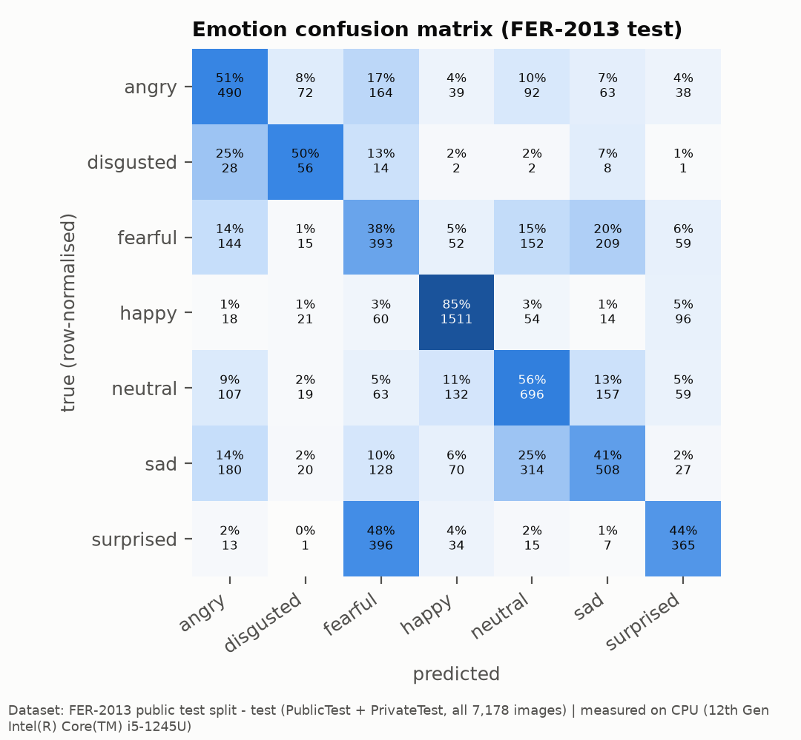
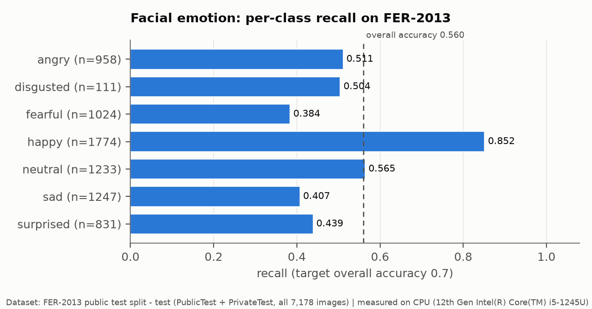

# Report figures

Generated by `eval/report_figures.py` from `eval/results/*.json` (charts) and a few seconds of inference on frozen dataset samples (qualitative panels). Do not edit by hand: rerun the script. Numbers below are exactly the ones drawn. Each image names its dataset in a footer; qualitative samples are the first items of the frozen manifest plus the first failure, never hand-picked.

Regenerate (repo root): `backend/.venv/bin/python eval/report_figures.py` (Windows: `backend\.venv\Scripts\python eval\report_figures.py`).

## emotion_confusion.png

**Caption.** Row-normalised confusion matrix (percent of the true class, with counts) on FER-2013 test.

**Data.** FER-2013 public test split - test (PublicTest + PrivateTest, all 7,178 images) | measured on CPU (12th Gen Intel(R) Core(TM) i5-1245U). Source: `eval/results/emotion.json`. Generated 2026-11-15 04:30.

**Numbers shown.**

- angry: angry 490, disgusted 72, fearful 164, happy 39, neutral 92, sad 63, surprised 38
- disgusted: angry 28, disgusted 56, fearful 14, happy 2, neutral 2, sad 8, surprised 1
- fearful: angry 144, disgusted 15, fearful 393, happy 52, neutral 152, sad 209, surprised 59
- happy: angry 18, disgusted 21, fearful 60, happy 1511, neutral 54, sad 14, surprised 96
- neutral: angry 107, disgusted 19, fearful 63, happy 132, neutral 696, sad 157, surprised 59
- sad: angry 180, disgusted 20, fearful 128, happy 70, neutral 314, sad 508, surprised 27
- surprised: angry 13, disgusted 1, fearful 396, happy 34, neutral 15, sad 7, surprised 365

## emotion_per_class.png

**Caption.** Per-class recall of the shipped AffectNet-trained emotion model on the FER-2013 test split (cross-dataset); the dashed line is the overall 7-class accuracy. Measured on CPU (12th Gen Intel(R) Core(TM) i5-1245U).

**Data.** FER-2013 public test split - test (PublicTest + PrivateTest, all 7,178 images) | measured on CPU (12th Gen Intel(R) Core(TM) i5-1245U). Source: `eval/results/emotion.json`. Generated 2026-11-15 04:30.

**Numbers shown.**

- overall accuracy 0.5599
- macro recall 0.5232
- angry: 0.5115 (n=958)
- disgusted: 0.5045 (n=111)
- fearful: 0.3838 (n=1024)
- happy: 0.8517 (n=1774)
- neutral: 0.5645 (n=1233)
- sad: 0.4074 (n=1247)
- surprised: 0.4392 (n=831)

## Not generated yet

- `summary`: not run yet - run the evaluations and this script on the demo PC
- `detection`: not run yet - run the evaluations and this script on the demo PC
- `tracking`: not run yet - run the evaluations and this script on the demo PC
- `reid`: not run yet - run the evaluations and this script on the demo PC
- `reid_caviar`: not run yet - run the evaluations and this script on the demo PC
- `reid_finetune`: not run yet - run the evaluations and this script on the demo PC
- `crowd`: not run yet - run the evaluations and this script on the demo PC
- `demographics`: not run yet - run the evaluations and this script on the demo PC
- `fire`: not run yet - run the evaluations and this script on the demo PC
- `throughput`: not run yet - run the evaluations and this script on the demo PC
- `search_latency`: not run yet - run the evaluations and this script on the demo PC
- `synopsis`: not run yet - run the evaluations and this script on the demo PC
- `adversarial`: not run yet - run the evaluations and this script on the demo PC
- `q_detection`: not run yet - run the evaluations and this script on the demo PC
- `q_tracking`: not run yet - run the evaluations and this script on the demo PC
- `q_reid`: not run yet - run the evaluations and this script on the demo PC
- `q_crowd`: not run yet - run the evaluations and this script on the demo PC
- `q_fire`: not run yet - run the evaluations and this script on the demo PC
- `q_emotion`: not run yet - run the evaluations and this script on the demo PC
- `q_demographics`: not run yet - run the evaluations and this script on the demo PC
- `q_adversarial`: not run yet - run the evaluations and this script on the demo PC
